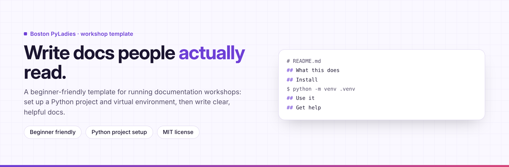

# pyladies-doc-workshop

Boston PyLadies Documentation Workshop

A beginner-friendly template for running documentation workshops. Includes guides for setting up a Python project, creating virtual environments, and writing clear, helpful documentation. Perfect for community events, onboarding, or open source sprints.

-----------------------------------------------------------------------------------------------------------------------------------

🚀 How to Publish This on GitHub (Step-by-Step)
1. Create a New Repository
- Go to https://github.com/new
- Name it something like pyladies-docs-workshop
- Add a short description (use the one above)
- Leave it empty (don’t initialize with README)

2. Unzip the Template
Download and unzip the file: 📦 pyladies_workshop_template.zip

3, Initialize Git Locally
cd pyladies_workshop_template
git init
git remote add origin https://github.com/your-username/pyladies-docs-workshop.git
git add .
git commit -m "Initial commit for PyLadies Docs Workshop"
git push -u origin main

-----------------------------------------------------------------------------------------------------------------------------------

⚙️ GitHub Actions Workflow for Contributions
Create a file at .github/workflows/contribution-check.yml:

name: Contribution Check

on:
  pull_request:
    branches: [ main ]

jobs:
  lint-docs:
    runs-on: ubuntu-latest
    steps:
      - name: Checkout code
        uses: actions/checkout@v3

      - name: Set up Python
        uses: actions/setup-python@v4
        with:
          python-version: '3.11'

      - name: Install markdownlint
        run: |
          pip install markdownlint-cli
          markdownlint **/*.md || true

      - name: Check for README and guide
        run: |
          test -f README.md
          test -f getting-started/guide.md

This GitHub Actions workflow file will:
- Run on every pull request to main
- Set up Python 3.11
- Lint all Markdown files
- Ensure README.md and getting-started/guide.md exist

-----------------------------------------------------------------------------------------------------------------------------------

